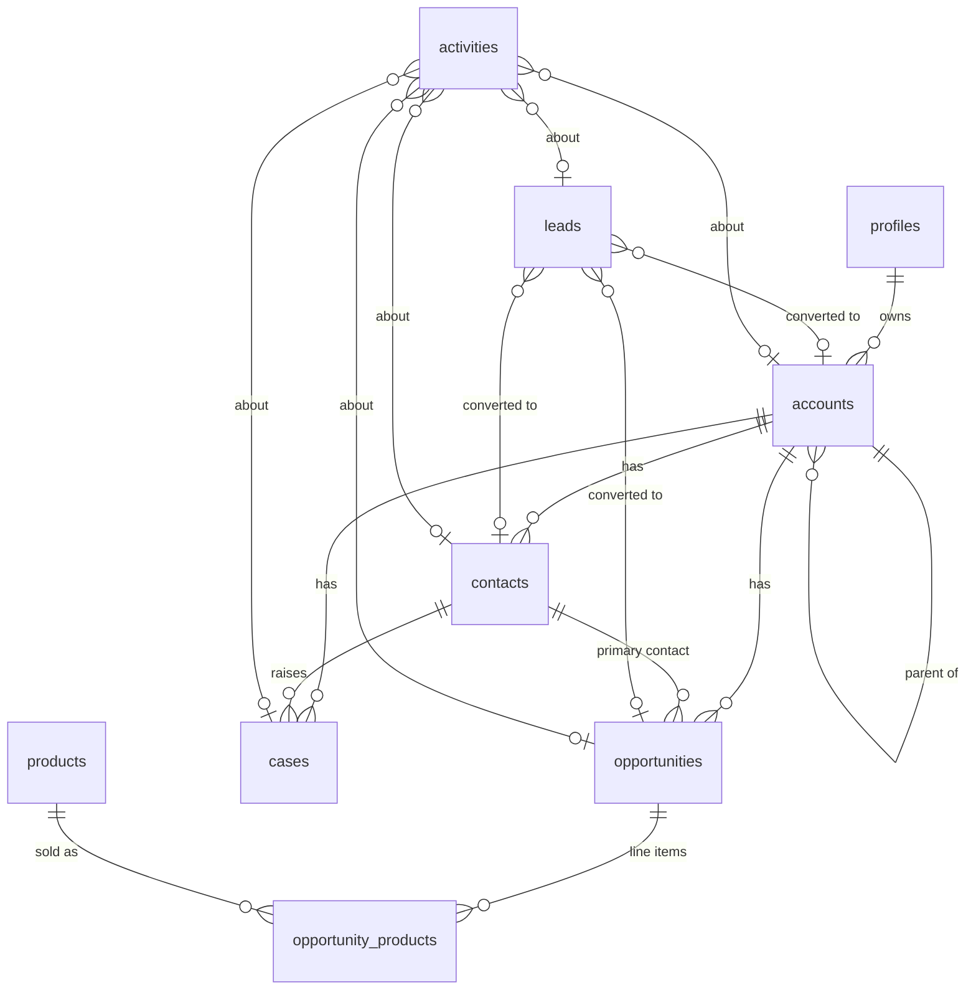

# Summit CRM

A Salesforce-style CRM built with **Next.js 15 (App Router)** and **Supabase** (Postgres, Auth, Row Level Security). Deploys to **Vercel** with zero config.

> Independent project, not affiliated with or endorsed by Salesforce, Inc.

## Features

- **Objects:** Accounts, Contacts, Leads, Opportunities, Products and opportunity line items, Cases, Activities (tasks, calls, emails, meetings, notes)
- **List views:** search, sorting, "owned by me" scope, quick filters by stage or status, pagination
- **Record pages:** highlights panel, stage/status **path** you can click to advance, details by section, related lists, activity timeline with quick logging, system info
- **Lead conversion:** Lead → Account (new or existing, with duplicate detection) + Contact + optional Opportunity, with activities carried over
- **Products & line items:** an opportunity's amount rolls up from its line items automatically
- **Home dashboard:** open and weighted pipeline, won this quarter, pipeline by stage, open tasks, deals closing soon, open cases
- **Global search** across every object
- **Users & roles:** the first sign-up becomes admin; admins can promote or demote users and delete any record

The UI is metadata-driven: each object is defined once in [`lib/objects.ts`](lib/objects.ts) (fields, sections, list columns, related lists, path), and one set of generic pages renders lists, records and forms for all of them. To add a field, add the column in a migration and one line to the object definition.

## Database schema

Migrations live in [`supabase/migrations`](supabase/migrations); demo data is in [`supabase/seed.sql`](supabase/seed.sql).



| Table | Purpose | Notable logic |
|---|---|---|
| `profiles` | One row per `auth.users` user: name, title, role (`admin` / `user`) | Created by trigger on sign-up; first user is admin; only admins can change roles |
| `accounts` | Companies, with optional parent account | Trigram index on name for search |
| `contacts` | People, optionally linked to an account | `full_name` generated column |
| `leads` | Unqualified prospects | `convert_lead()` RPC; tracks converted account, contact and opportunity |
| `opportunities` | Deals with stage, amount, close date | Probability defaults from stage; `is_closed` and `is_won` generated |
| `products` | Price list | |
| `opportunity_products` | Line items | Price defaults to list price; `total_price` generated; rolls up into `opportunities.amount` |
| `cases` | Support tickets | Auto case number (`00001001`…), `closed_at` stamped on close |
| `activities` | Tasks, calls, emails, meetings, notes linked to any record | `completed_at` stamped on completion |

Every CRM table has `owner_id`, `created_by`, `created_at` and `updated_at`. Triggers stamp `created_by` from the session and keep it, and `created_at`, from being changed.

Reporting views (`pipeline_by_stage`, `lead_funnel`, `cases_by_status`) use `security_invoker`, so they respect the caller's RLS.

### Security model

RLS is on for every table, and the sharing model is "public read/write" inside the org:

- Any signed-in user can **read, create and edit** all CRM records.
- Only the record **owner** or an **admin** can **delete**.
- Anonymous visitors can't see anything.
- `private.is_admin()` sits in a schema the API doesn't expose, and trigger helpers can't be called over the API.

For stricter sharing, such as owner-only visibility or teams, change the `select` and `update` policies in the migration.

## Run locally

```bash
cp .env.example .env.local   # values for the hosted project are pre-filled
npm install
npm run dev
```

Open http://localhost:3000 and sign up. The first account you create becomes the admin.

### Use your own Supabase project

1. Create a project and run `supabase/migrations/*.sql`, then optionally `supabase/seed.sql` (SQL editor, or `supabase db push`).
2. Put the project URL and publishable key (Settings → API) in `.env.local`.

## Deploy to Vercel

1. Import this GitHub repo in Vercel. The framework is detected as Next.js.
2. Add environment variables (Production, Preview and Development):
   - `NEXT_PUBLIC_SUPABASE_URL`
   - `NEXT_PUBLIC_SUPABASE_PUBLISHABLE_KEY`
   - `NEXT_PUBLIC_SITE_URL` (optional): your production URL, used in auth emails
3. Deploy.
4. In Supabase → **Authentication → URL Configuration**:
   - set **Site URL** to your Vercel URL
   - add `https://<your-app>.vercel.app/**` (and `http://localhost:3000/**`) to **Redirect URLs**

   Email-confirmation links won't return to the app until you do this. For quick testing you can turn off **Confirm email** under Authentication → Providers → Email.

`vercel.json` pins functions to `sin1` (Singapore), next to the Supabase project in `ap-southeast-1`.

## Project structure

```
app/
  (crm)/                 signed-in app shell (header, nav)
    page.tsx             home dashboard
    [object]/            generic list, new, record, edit pages for every object
    [object]/[id]/convert lead conversion
    search/, settings/
  login/                 sign in / sign up
  auth/callback, signout
components/              RecordForm, PathBar, FieldValue, ActivityComposer…
lib/
  objects.ts             object and field metadata
  actions.ts             server actions (save, delete, path, activities, convert)
  supabase/              server client, middleware session refresh
middleware.ts            redirects signed-out users to /login
supabase/                migrations + seed
```

## Demo data

The seed creates 6 accounts, 7 contacts, 6 leads, 7 opportunities (one with line items), 5 products, 4 cases and 5 activities. All the companies and people are fictional. To clear it:

```sql
truncate public.activities, public.opportunity_products, public.cases, public.leads,
         public.opportunities, public.contacts, public.products, public.accounts cascade;
```
